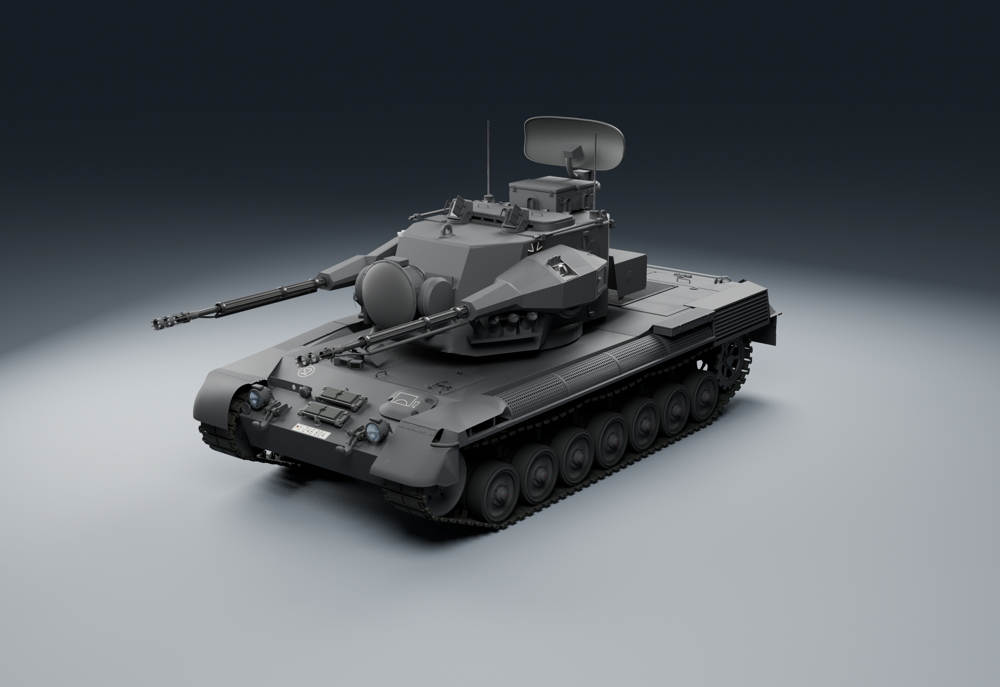
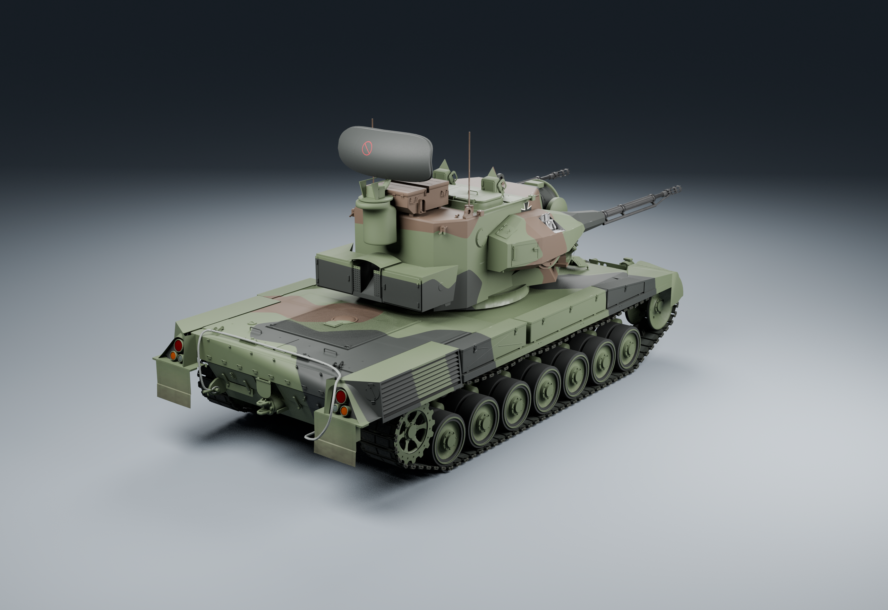
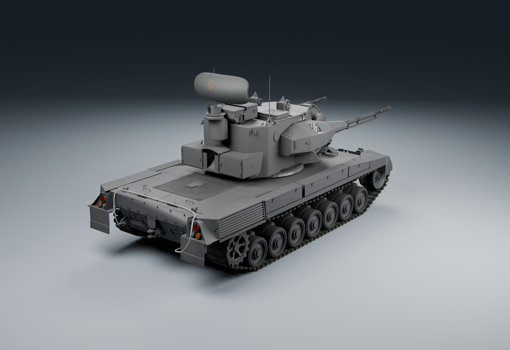
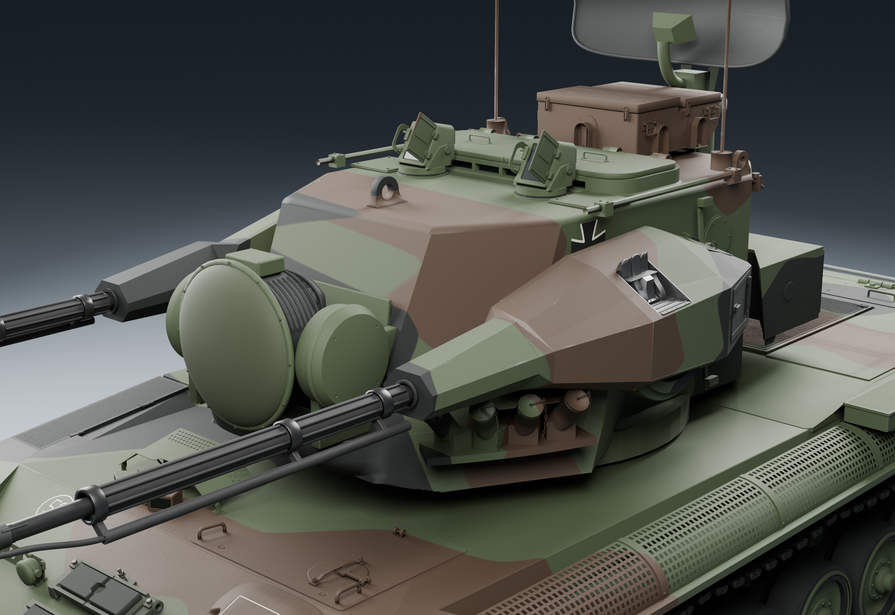
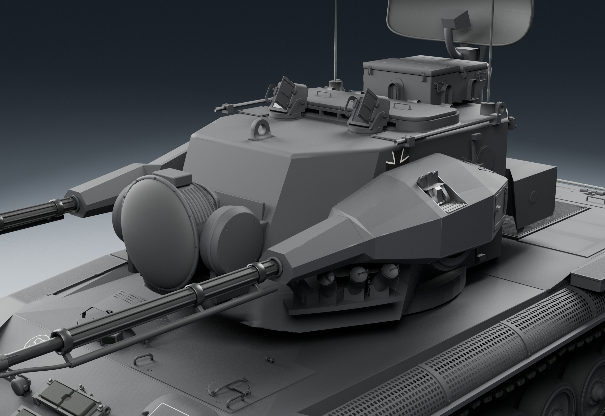

# Detail10 · historical Blender showcase

**Historical snapshot: 4 November 2026. This page and its download predate the current gallery.**

An editable, work-in-progress Gepard model with **camouflage** and **charcoal** finishes, detailed running gear, crew interiors and neutral grey mechanisms.

This showcase is based on the approved **Detail10 GreyMechanisms01** Blender source. It is a static authoring model. The Blender scenes do not establish functioning in-game mechanisms, real-world dimensional accuracy or a qualified Arma release.

## Blender gallery

Six full-resolution **2560 x 1760** Blender Cycles renders of the approved Detail10 source. Matching cameras show both finishes. Click any image for the original PNG.

| Camouflage | Charcoal |
| --- | --- |
|  **Front three-quarter** |  **Front three-quarter** |
|  **Rear three-quarter** |  **Rear three-quarter** |
|  **Turret and grey mechanism detail** |  **Turret and grey mechanism detail** |

These are Blender studio presentation images, not in-game screenshots or photographs of a real vehicle. Cameras, studio lighting, color management and a matte floor were set for the gallery; model geometry, materials, textures and assembly were unchanged. No generative imagery or post-render retouching was used. [Render provenance and attribution](images/RENDER-PROVENANCE.md) · [Image checksums](images/manifest.json).

## Model

Download the model and its notices from the [Detail10 showcase release](https://github.com/mortal414/gepard-blender-showcase/releases/tag/detail10-showcase-2026-11-04). Extract `Gepard-Detail10-Public.blend` from the ZIP. This is a metadata-cleaned derivative of `Gepard-Detail10-GreyMechanisms01.blend`. The original is preserved privately, unchanged.

Open in **Blender 4.5 LTS**. Choose `REFINEMENT_Camo` or `REFINEMENT_Charcoal` from the scene selector. All 246 image records retain their packed data. The [validation record](sanitization-validation.json) identifies the download's SHA-256 and verifies geometry, normals, UVs, scene membership, material assignments, shader inputs and packed image bytes after saving and reopening both scenes. Numerical custom settings are preserved.

The public derivative removes embedded development text and custom metadata, replaces historical image paths with portable paths, and removes render-output paths. Its file hash therefore differs from the original. The approved original is 491,250,653 bytes, SHA-256 `a530657f4e191c69df6cc09da630671cd2d03c879c009c4715573b902bf8d979`.

## Rights and attribution

See [RIGHTS.md](RIGHTS.md). A blanket reuse license has **not** been established for the complete model. Public availability alone does not grant permission to reuse third-party material.

## Arma project

The separate [Gepard Arma Reforger project](https://github.com/mortal414/gepard) documents the currently published game release. This model showcase does not update the Workshop mod. Game integration remains subject to testing and acceptance.
