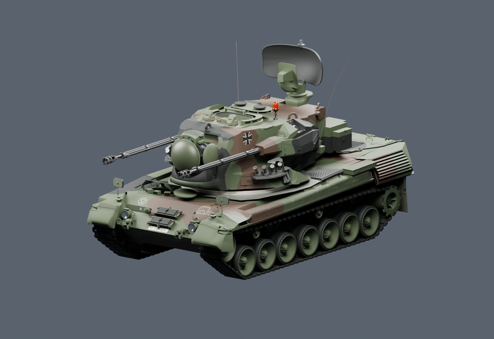
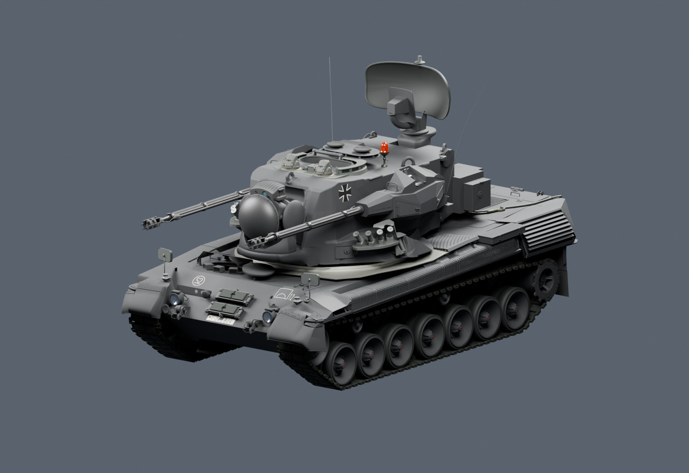
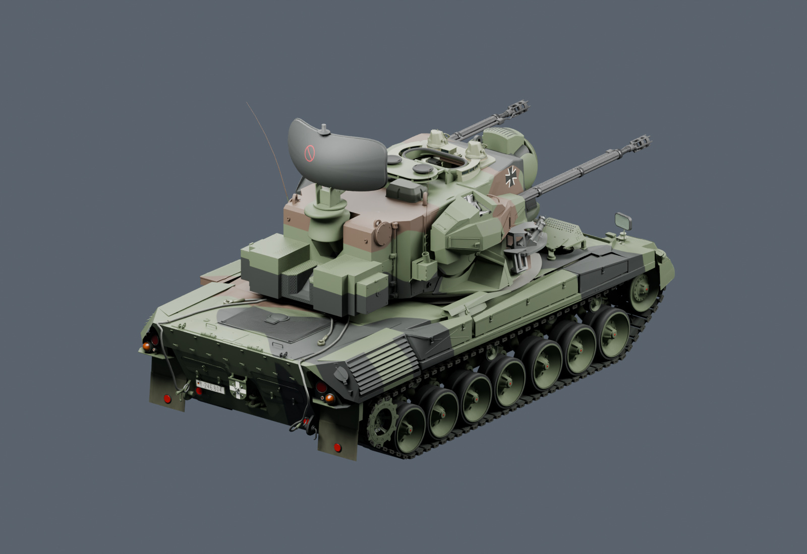
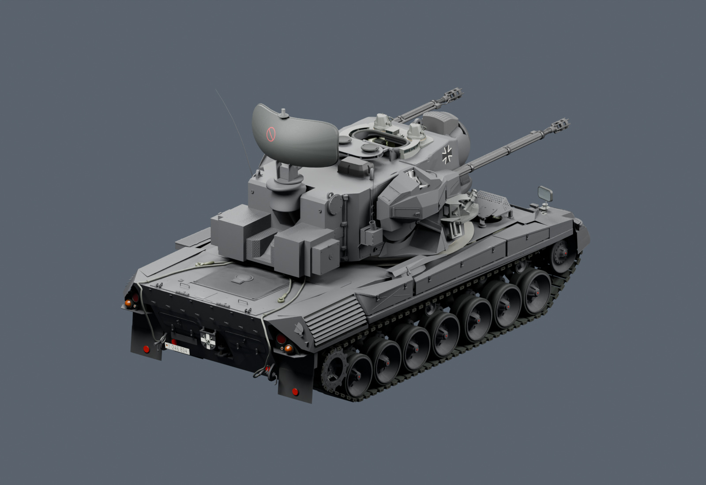
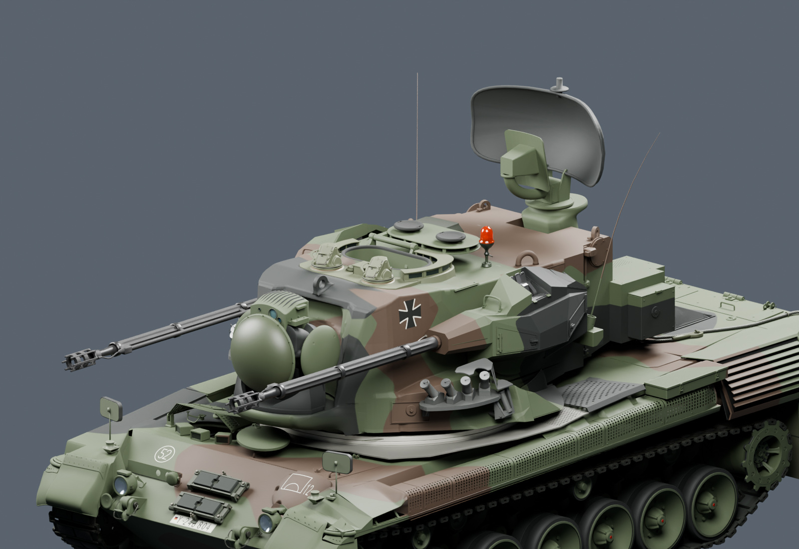
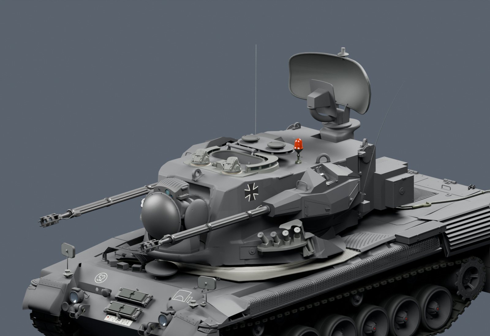
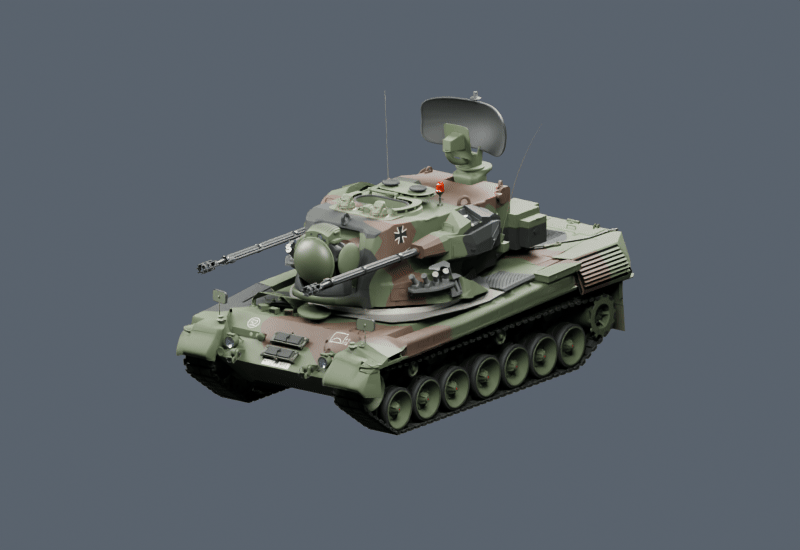

# Gepard 1A2

A work-in-progress Blender model in camouflage and charcoal.

## Gallery · 17 November 2026

| Camouflage | Charcoal |
| --- | --- |
|  |  |
| Front three-quarter | Front three-quarter |
|  |  |
| Rear three-quarter | Rear three-quarter |
|  |  |
| Turret and radar | Turret and radar |

### Turntable

[Watch the MP4](images/r33/camo-turntable.mp4)

Blender renders, not the current [Arma Reforger release](https://github.com/mortal414/gepard).

[Earlier model: 4 November](DETAIL10-ARCHIVE.md) · [Rights and attribution](RIGHTS.md)
