# Gepard 1A2

A Blender showcase of the Gepard 1A2 exterior in Camo and Charcoal. **R42** is the current showcase revision, with Base and Equipped configurations. Both models also include a neutral clay scene.

## R42 Base · default

[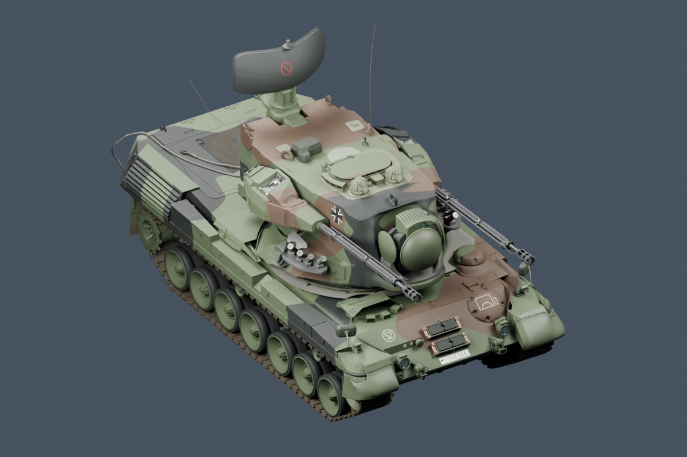](images/r42/R42_Base_Camo_overall.jpg)

The clean configuration has the removable boxes and roof beacon off.

**[Base model and private Blender download](models/R42-Base.md)** · [Full Base gallery](galleries/R42.md#base)

## R42 Equipped

Roof boxes, rear stowage and the amber roof beacon are fitted.

| Camo | Charcoal |
| --- | --- |
| [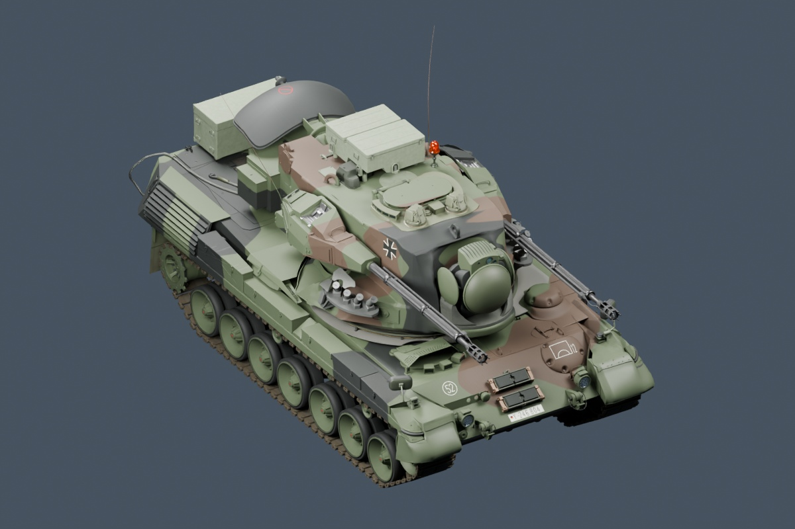](images/r42/R42_Equipped_Camo_overall.jpg) | [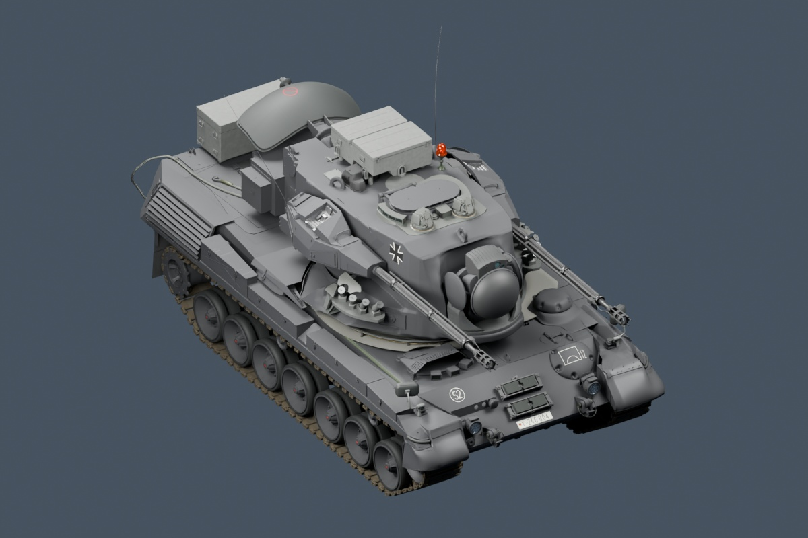](images/r42/R42_Equipped_Charcoal_overall.jpg) |

**[Equipped model and private Blender download](models/R42-Equipped.md)** · [Full Equipped gallery](galleries/R42.md#equipped)

## Exterior details · R42

| View | View |
| --- | --- |
| [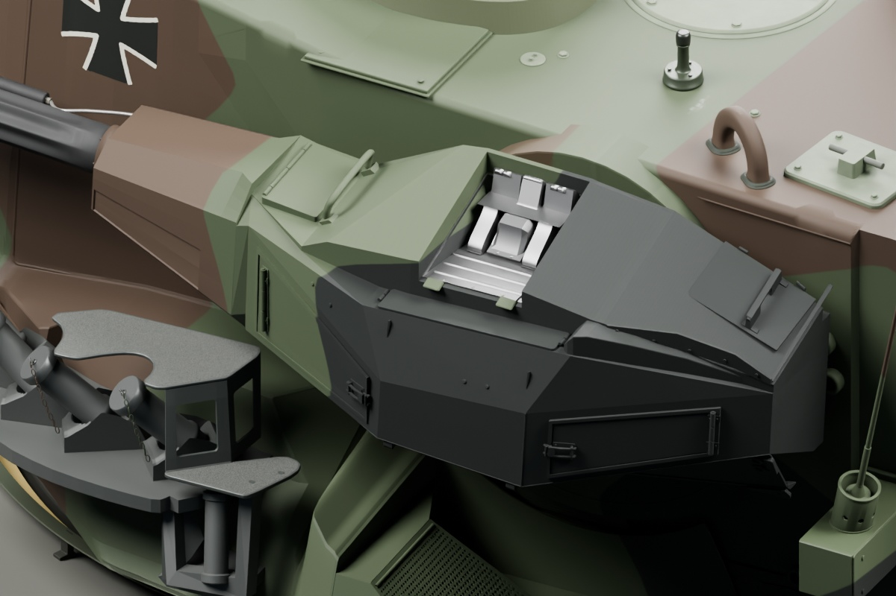](images/r42/R42_Base_Camo_arm_left.jpg) | [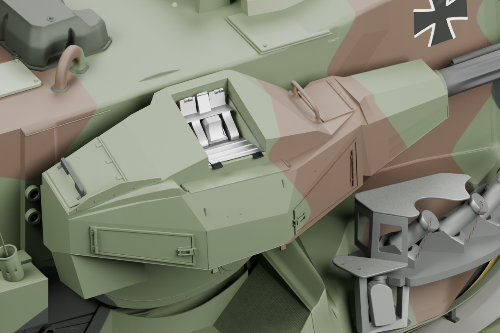](images/r42/R42_Base_Camo_arm_right.jpg) |
| [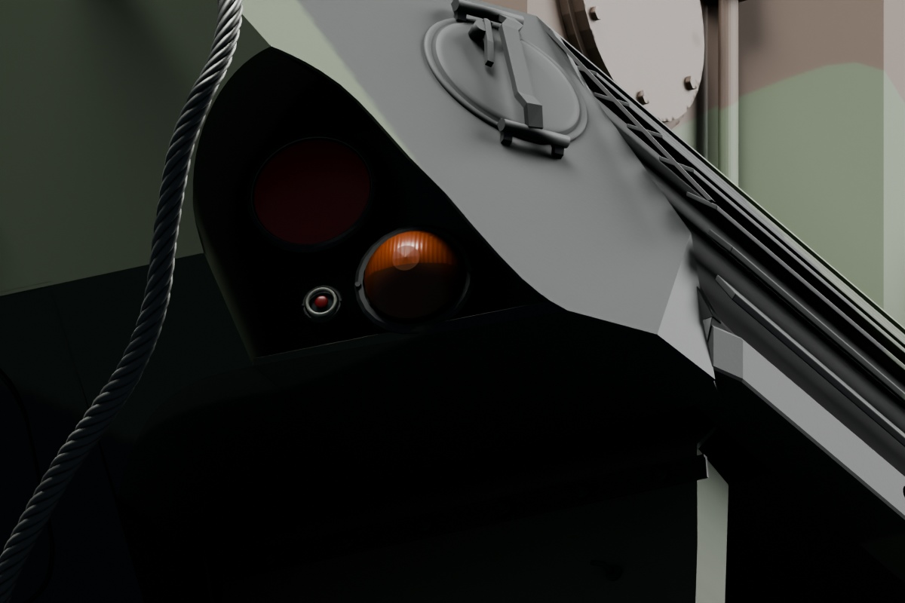](images/r42/R42_Base_Camo_lamp_underside_right.jpg) | [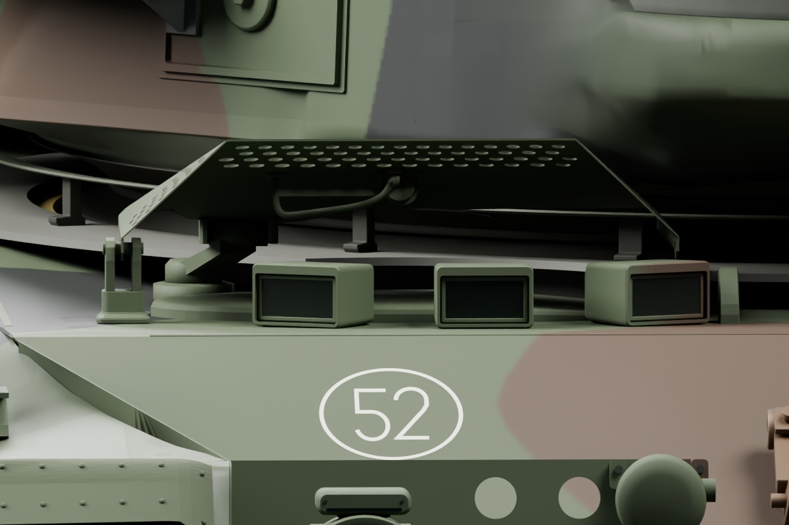](images/r42/R42_Base_Camo_hatch_closed.jpg) |
| [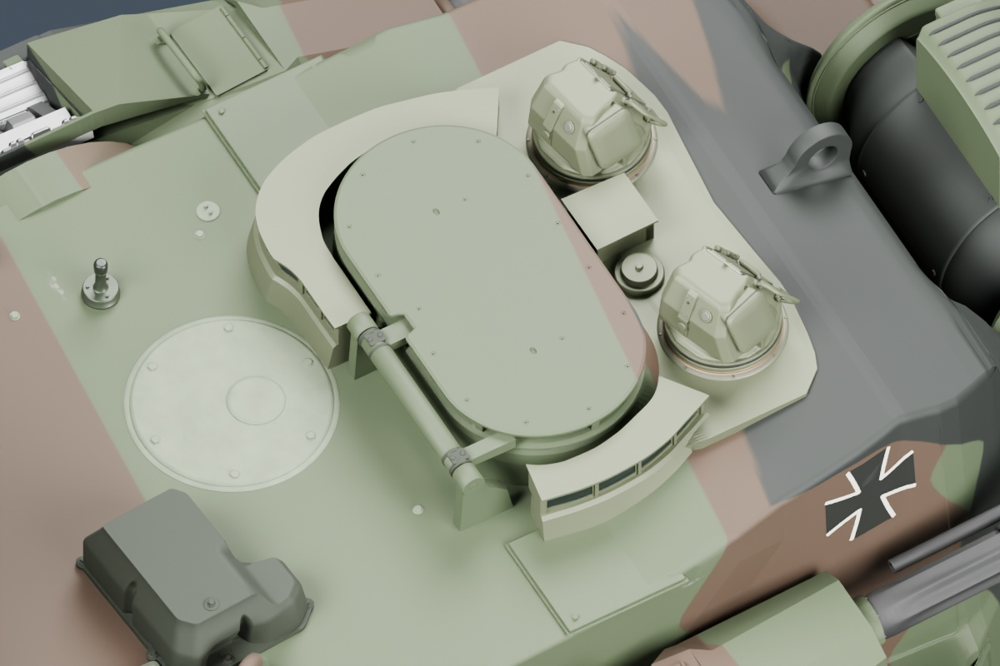](images/r42/R42_Base_Camo_roof.jpg) | [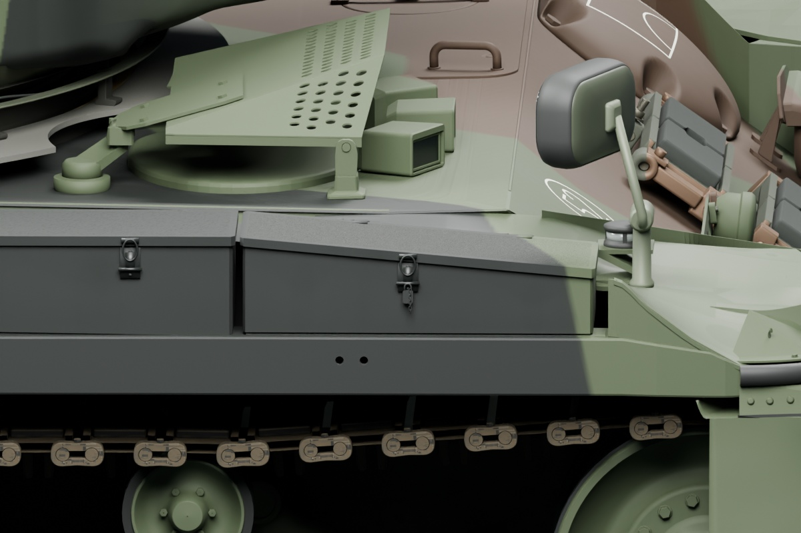](images/r42/R42_Base_Camo_locker_outer.jpg) |
| [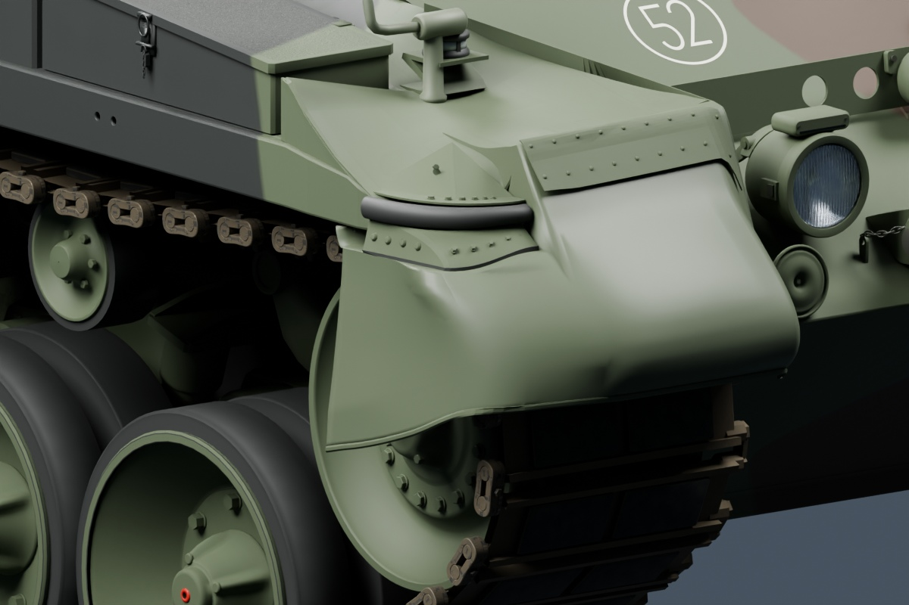](images/r42/R42_Base_Camo_fender.jpg) | [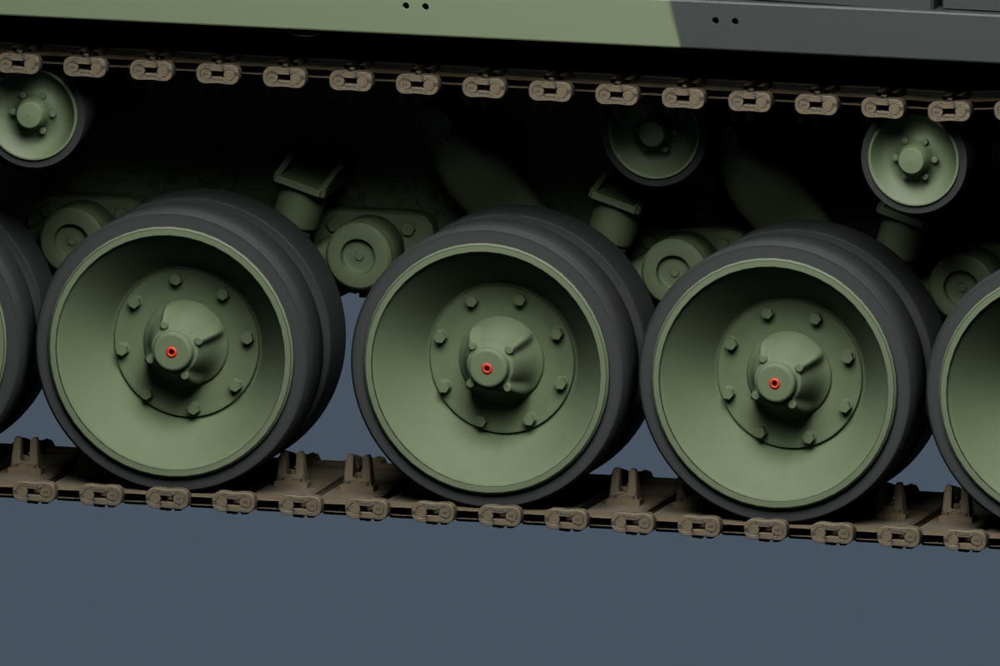](images/r42/R42_Base_Camo_wheel.jpg) |

[View all 33 R42 renders](galleries/R42.md), including both finishes and the driver’s visor opening preview.

## Earlier turntables · R41

| R41 Base · Camo | R41 Equipped · Camo |
| --- | --- |
| 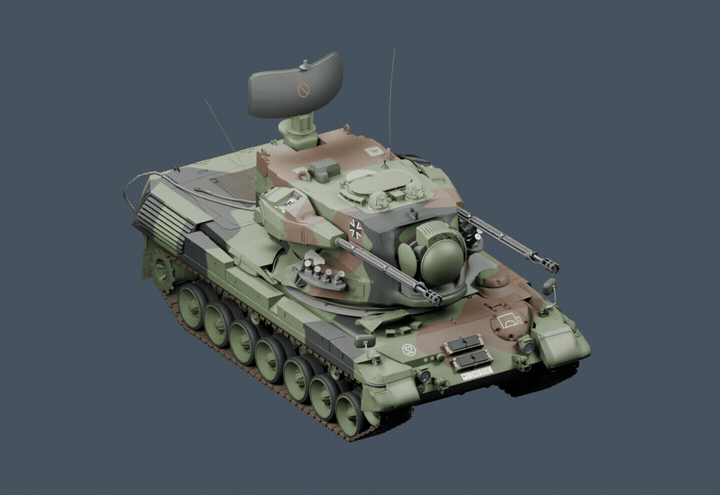 | 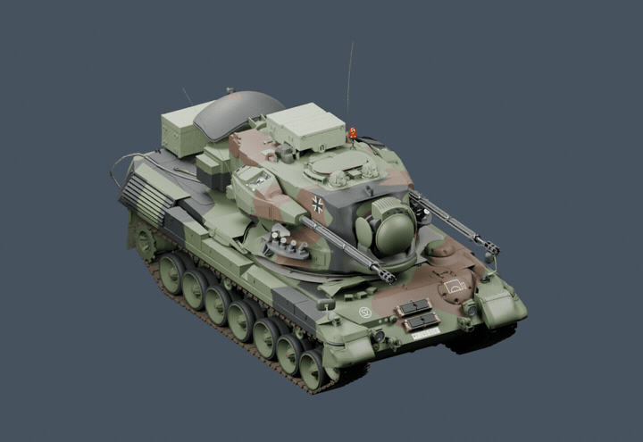 |

[R41 turntables in Camo and Charcoal, with MP4 downloads](galleries/R41.md) · [R41 overview archive](R41-ARCHIVE.md)

[Revision history](HISTORY.md) · [R42 rendering notes and checksums](images/r42/RENDERING.md) · [Rights and attribution](RIGHTS.md)
