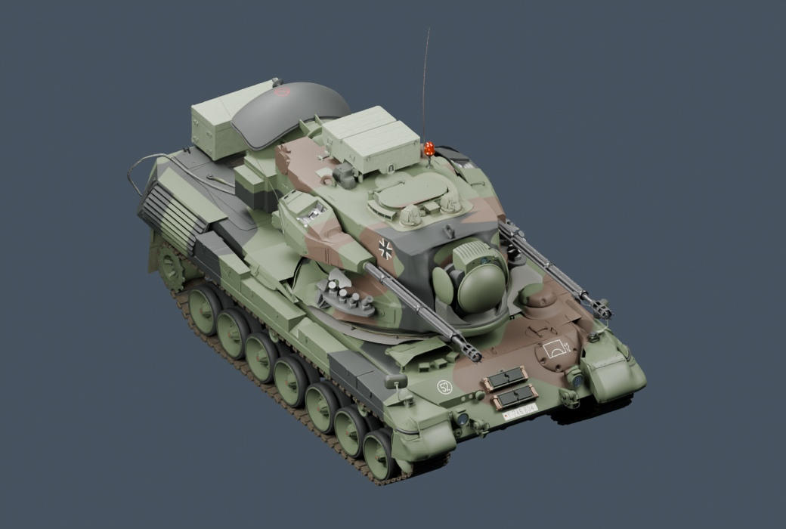
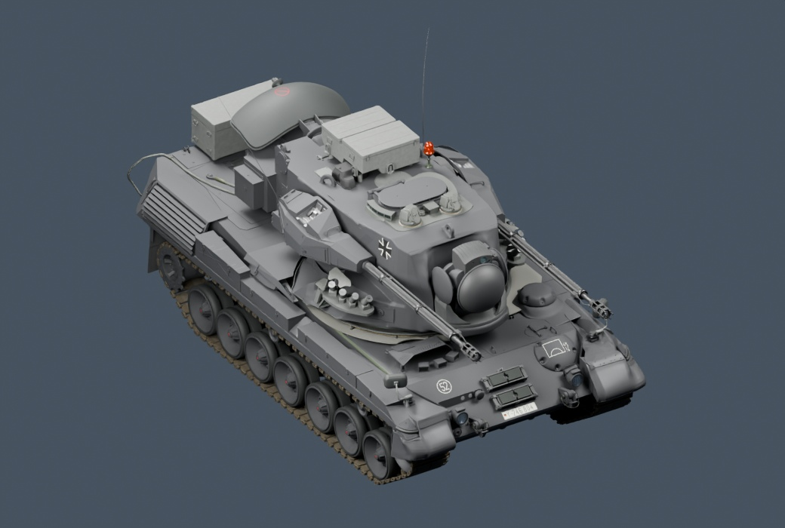
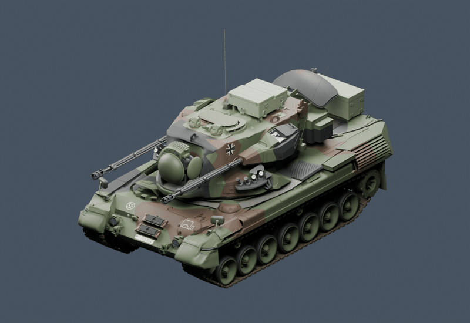

# Gepard 1A2

A Blender showcase of the Gepard 1A2 exterior, presented in Camo and Charcoal. **R41** is the current showcase revision, available in Base and Equipped configurations. Both Blender models also include a neutral clay scene.

## R41 Base · default

The clean configuration has the removable stowage boxes and roof beacon off.

**[Base model and private Blender download](models/R41-Base.md)** · [Full Base gallery](galleries/R41.md#base)

## R41 Equipped

The equipped configuration adds the removable roof and rear stowage boxes and the amber roof beacon.

| Camo | Charcoal |
| --- | --- |
|  |  |

**[Equipped model and private Blender download](models/R41-Equipped.md)** · [Full Equipped gallery](galleries/R41.md#equipped)

## Turntables

### R38 · earlier exterior checkpoint

[Watch the R38 MP4](images/r38/camo-turntable.mp4) · [R38 gallery](R38-ARCHIVE.md)

[R33 turntable · MP4](images/r33/camo-turntable.mp4) · [R33 gallery](R33-ARCHIVE.md)

## Explore the model

- [Full R41 gallery](galleries/R41.md) — all 15 model renders, including the driver’s visor, deck, turret landings, side guards and steps.
- [Revision history](HISTORY.md) — R41 changes and earlier galleries, including the R38 turntable.
- [Rights and attribution](RIGHTS.md).
