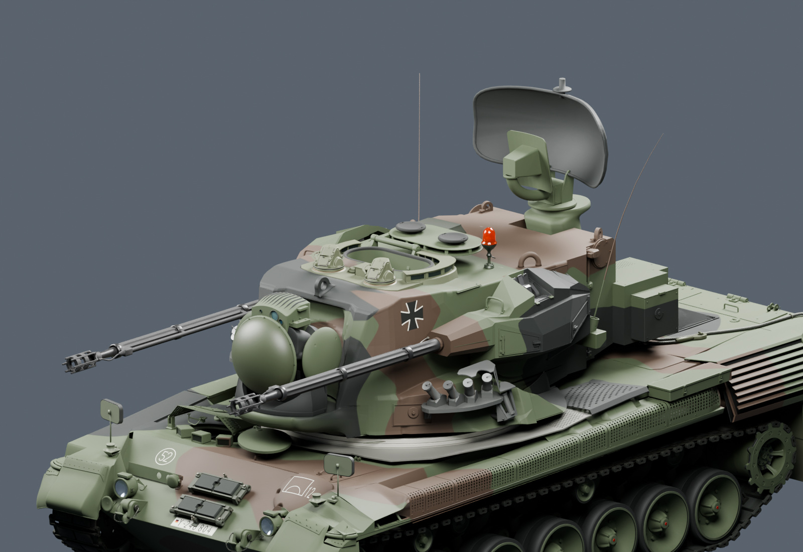
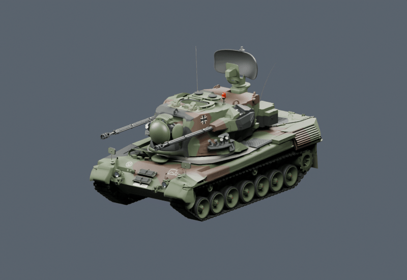

# Gepard · Blender showcase

A visual workbench for an ongoing **Gepard 1A2** model, from whole-vehicle silhouettes to the small fittings that give it character. Two finishes, camouflage and charcoal, are shown from matching cameras.

**Current gallery: R33, accepted 16 November 2026.** This is Blender authoring progress, ahead of game integration. It is not the model currently available in the [published Arma Reforger mod](https://github.com/mortal414/gepard).

[Gallery](#gallery) · [What changed](#what-changed) · [Project roles](#project-roles) · [Status and limits](#status-and-limits) · [Earlier work](#earlier-work)

## Gallery

Fresh Blender Cycles renders, made on 17 November 2026 from the accepted model. The source geometry, materials and saved pose were left unchanged. Cameras, lighting and color management are presentation-only. These are model renders, not photographs or in-game screenshots.

| Camouflage | Charcoal |
| --- | --- |
|  |  |
| **Front three-quarter** | **Front three-quarter** |
|  |  |
| **Rear three-quarter** | **Rear three-quarter** |
|  |  |
| **Turret and tracking radar** | **Turret and tracking radar** |

### Around the model

A genuine 360° Blender camera orbit of the camouflage model in its saved pose. The model stays still; this is a presentation turntable, not a demonstration of mechanical operation. [Watch or download the MP4](images/r33/camo-turntable.mp4) · [Rendering notes](images/r33/RENDERING.md)

## What changed

The current authoring milestone brings a substantial rebuild of the visible vehicle:

- Revised bow shoulders, front guards and recovery fittings.
- Reworked turret cheek transitions, smoke banks and tracking-radar assembly.
- Rebuilt gun mounts and coordinated model articulation.
- Revised idler placement, track loops, engine deck and stern details.
- Further crew-interior, turret-bearing and rear-equipment work.

The gallery concentrates on the exterior. It does not document every interior change or certify every articulated pose.

## Project roles

Marco Betti leads the creative direction, reference review, visual feedback and acceptance decisions. AI-assisted tools support the Blender implementation and iteration. Playtesting and release qualification belong to the separate Arma Reforger project.

## Status and limits

**Work in progress.** Remaining uncertainties include the concealed idler carrier, exact lower turret-cheek shape, bearing shielding and real mechanical travel limits. Reference-based visual review is not dimensional certification. Model controls and sampled clearances do not establish the real vehicle's operational limits or game readiness.

The [Arma Reforger repository](https://github.com/mortal414/gepard) documents the separately released playable mod. This gallery update does not change that release or publish a new Workshop build.

## Earlier work

The [4 November Detail10 archive](DETAIL10-ARCHIVE.md) preserves the previous six-image gallery and its historical source download. That download is an **older model**, not the R33 model shown above. The current update publishes presentation media and documentation only; it does not distribute a new Blender source file.

## Rights and attribution

See [RIGHTS.md](RIGHTS.md). Existing component notices remain in force. No blanket reuse license has been established for the complete model or its textures. Public viewing does not grant reuse rights to third-party material. No private reference photographs, comparison boards or development notes are included in this gallery.
