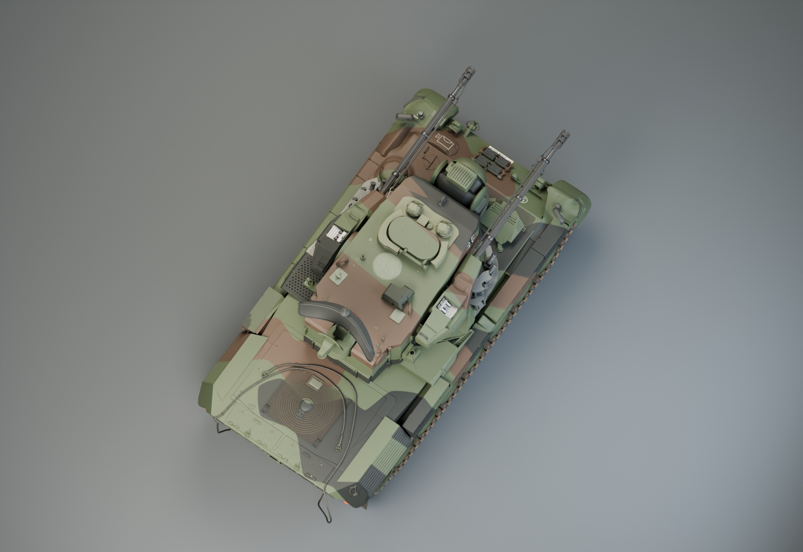
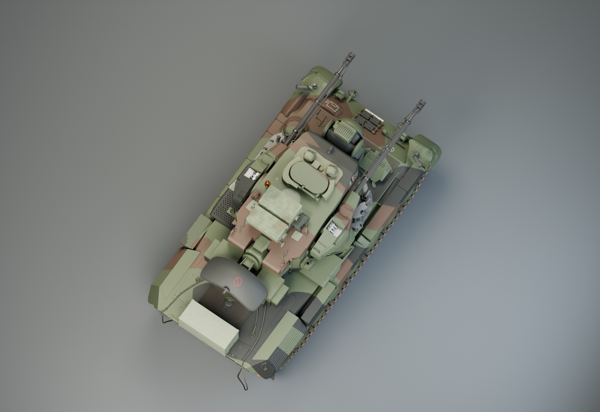
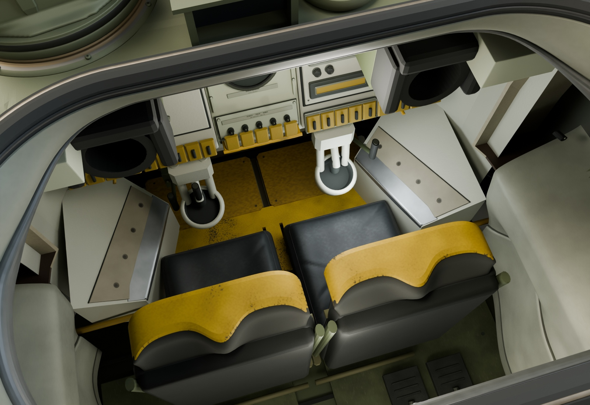
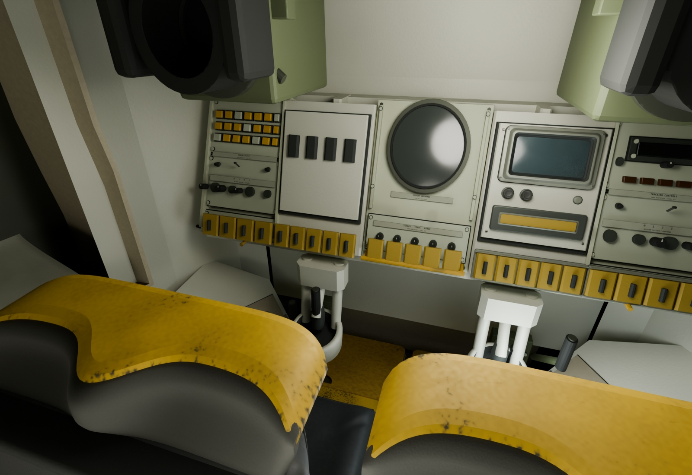

# Gepard 1A2

A Blender model of the Gepard 1A2, with exterior, driver’s station and crew-compartment views. **R57 is the current working version. Base is the default model; Equipped adds the optional stowage and beacon.** Paint and skins remain provisional.

[Exterior](#exterior) · [Interior](#interior) · [Neutral geometry](#neutral-geometry) · [Full gallery](galleries/R57.md) · [Previous R56 checkpoint](models/R56.md)

## Base · default

The clean configuration omits the removable stowage boxes and roof beacon.

**[Base model and private Blender source](models/R57-Base.md)** · [Base gallery](galleries/R57.md#base)

## Equipped · optional stowage

Roof boxes, rear stowage and the roof beacon are fitted. The native file contains both Camo and Charcoal, as does Base.

**[Equipped model and private Blender source](models/R57-Equipped.md)** · [Equipped gallery](galleries/R57.md#equipped)

## Exterior

| Base | Equipped |
| --- | --- |
|  |  |
|  |  |

Matching studio views show the hull, running gear, turret, gun assemblies, radar and equipment layout. [More exterior angles and both painted finishes](galleries/R57.md).

## Interior

### Driver’s station

### Crew compartment

### Seating and controls

Interior views show the hatches open and seats unfolded. [Both configurations and the complete interior set](galleries/R57.md).

## Neutral geometry

| Base | Equipped |
| --- | --- |
|  |  |

Neutral clay scenes are included in both Blender files for studying the form independently of the paint.

## Model records and earlier work

- [Full R57 model gallery](galleries/R57.md) — 22 fresh exterior and interior renders.
- [Previous working checkpoint · R56](models/R56.md) — both source configurations preserved.
- [Revision history](HISTORY.md) · [R57 detail notes](galleries/R57-DETAILS.md).
- [Earlier R41 turntables](galleries/R41.md) · [Earlier R47 exterior/interior gallery](galleries/R47.md).
- [Rendering and verification notes](images/r57/RENDERING.md) · [Rights and attribution](RIGHTS.md).
