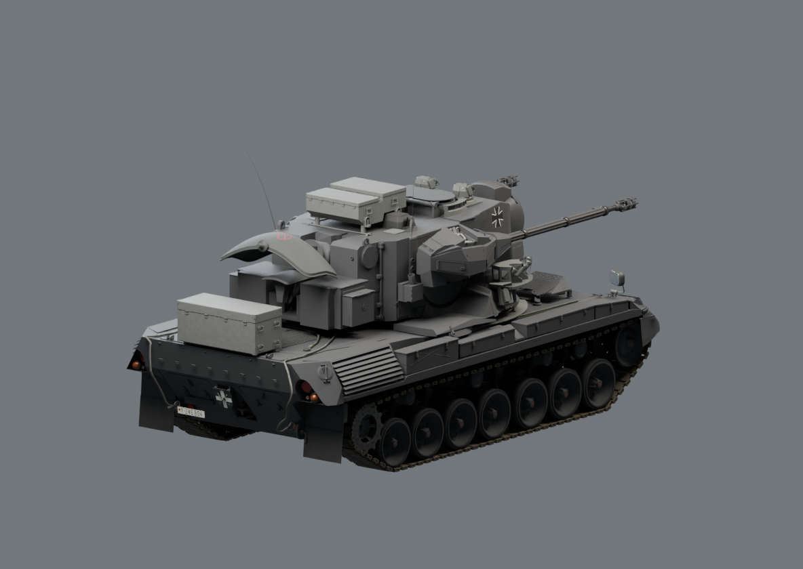
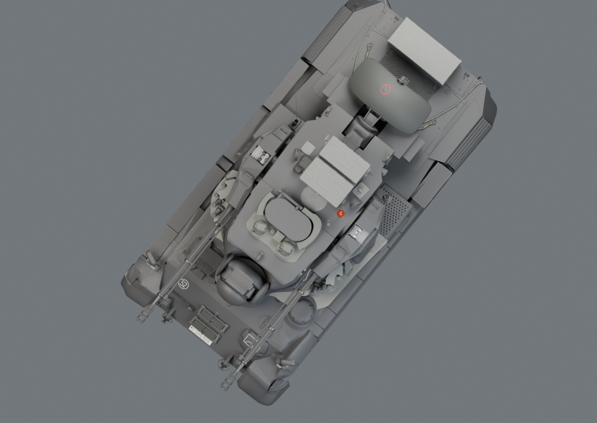
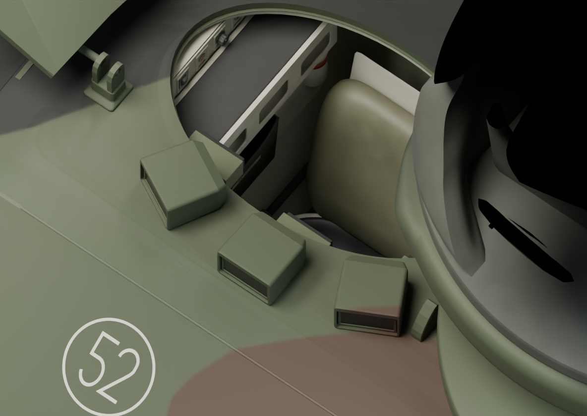
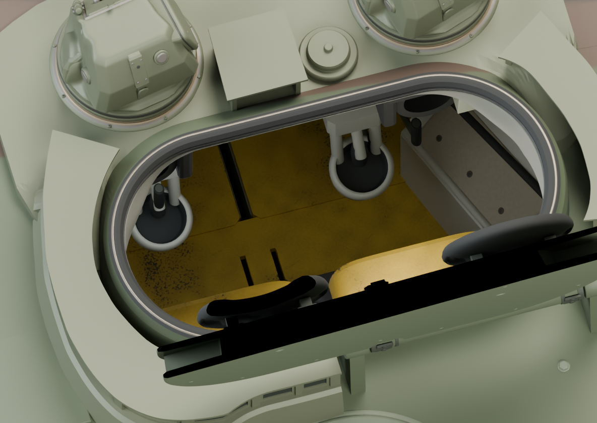
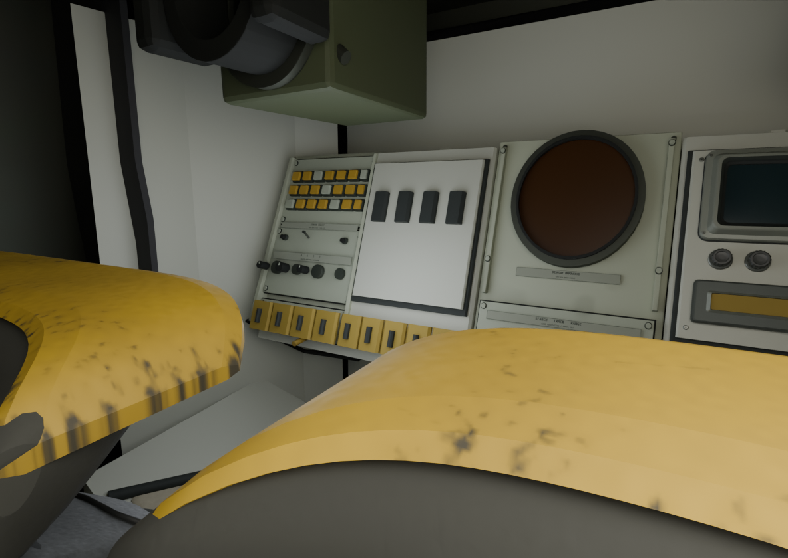
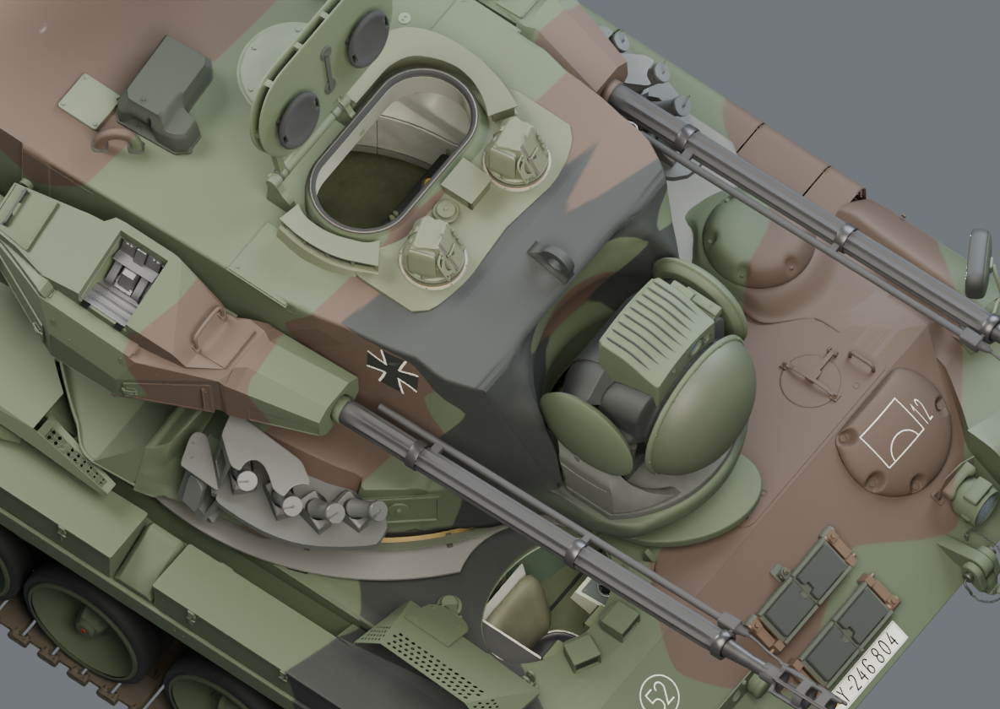
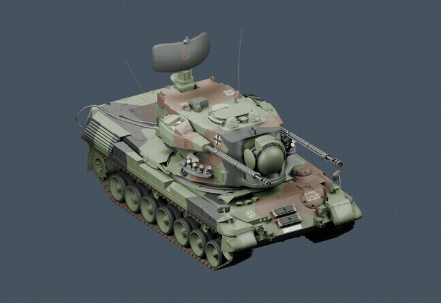
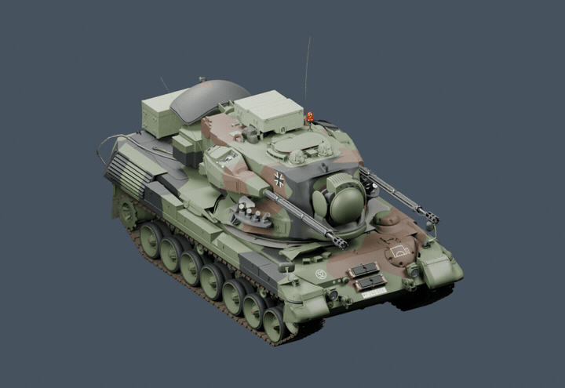

# Gepard 1A2

The **R47** reviewed Blender model, shown in the supplied Camo and Charcoal renders with exterior and interior views. Base is the default configuration; Equipped adds the optional stowage and beacon. Both native files also include Charcoal and neutral clay scenes.

## R47 Base · default

The clean configuration has the removable stowage boxes and roof beacon off.

**[Base model and private Blender download](models/R47-Base.md)** · [Base gallery](galleries/R47.md#base)

## R47 Equipped

The optional configuration has the roof boxes, rear stowage and amber roof beacon fitted. The rear view shows the stowage layout.

**[Equipped model and private Blender download](models/R47-Equipped.md)** · [Equipped gallery](galleries/R47.md#equipped)

## Model gallery · R47

| Base | Equipped |
| --- | --- |
|  |  |
|  |  |
|  |  |
|  |  |
|  |  |
|  |  |
|  |  |

[All 16 R47 renders](galleries/R47.md) · [R47 revision notes](HISTORY.md#r47--current-showcase) · [Rendering provenance and checksums](images/r47/RENDERING.md)

## Earlier turntables · R41

| R41 Base · Camo | R41 Equipped · Camo |
| --- | --- |
|  |  |

[R41 turntables in both finishes and MP4 downloads](galleries/R41.md) · [R42 gallery](galleries/R42.md)

[Revision history](HISTORY.md) · [Rights and attribution](RIGHTS.md)
