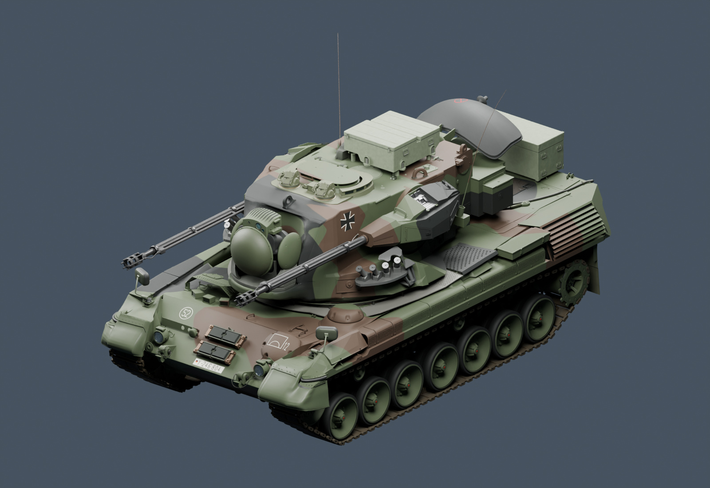
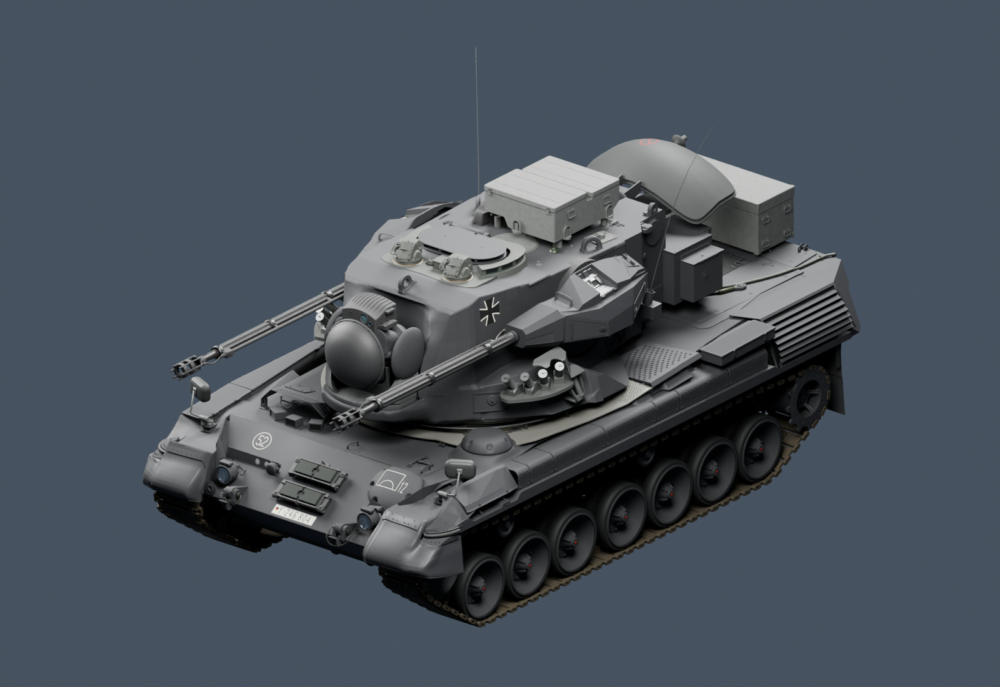
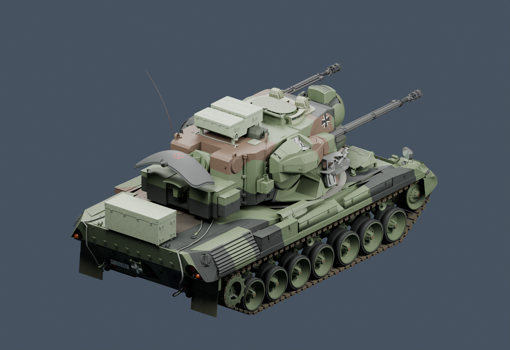
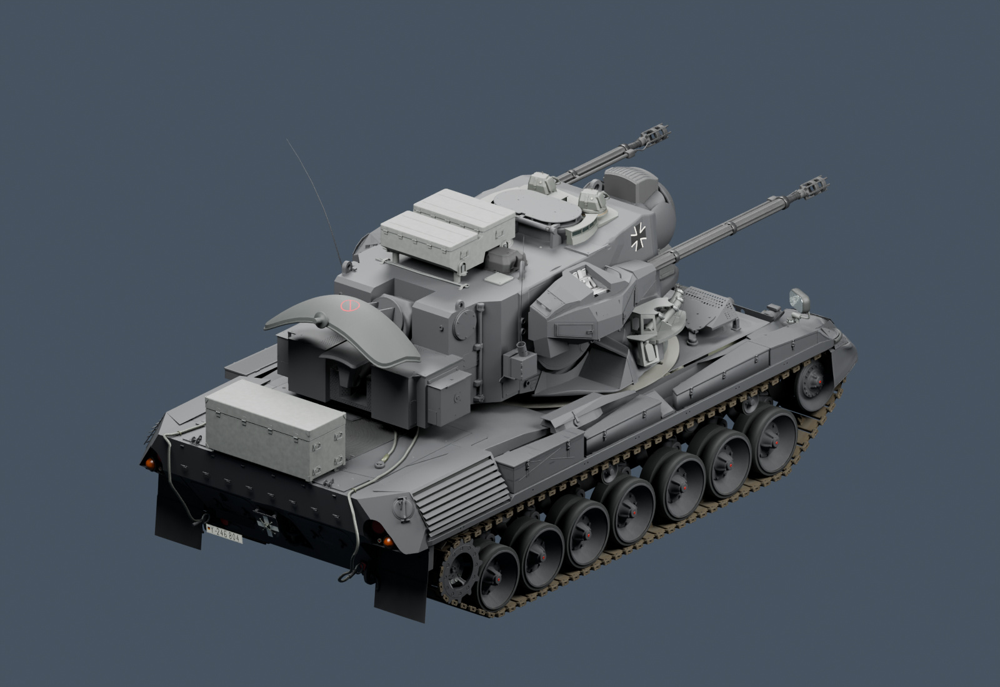
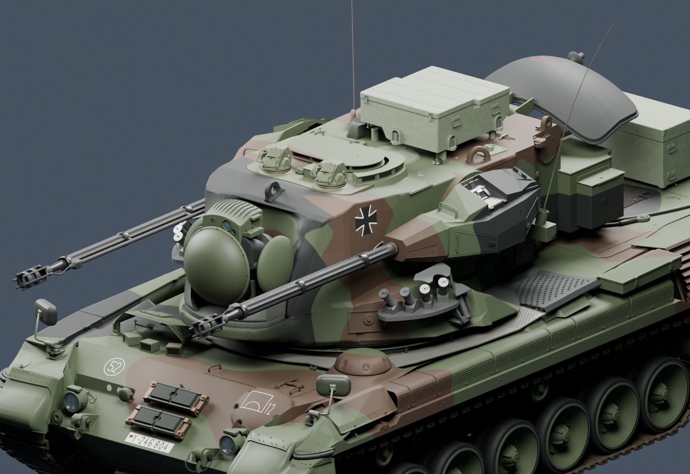
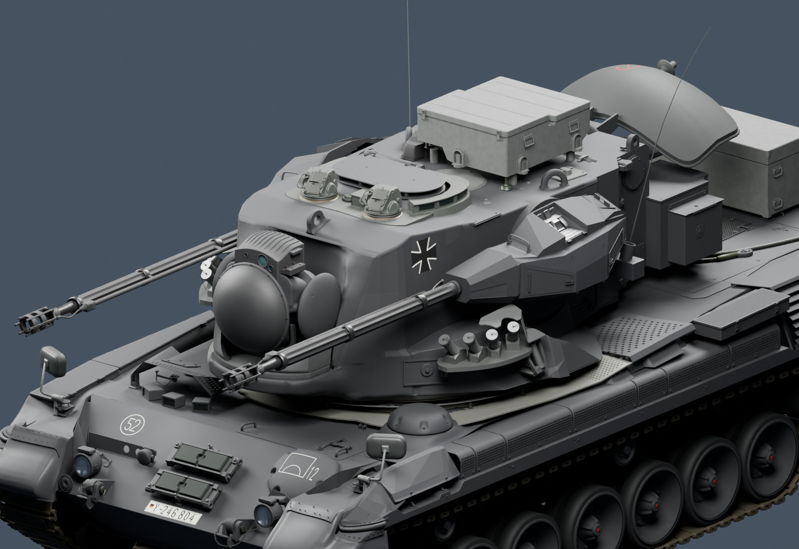
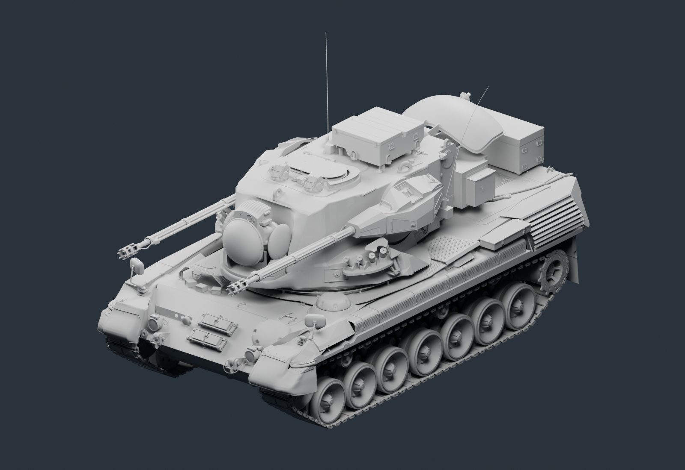
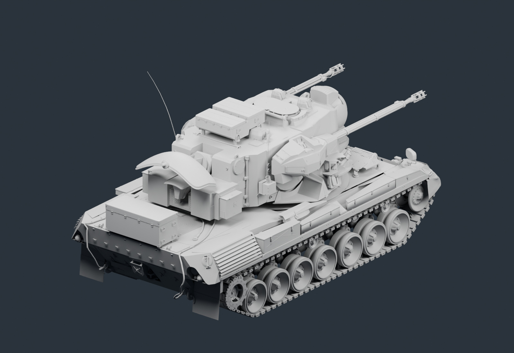

# Gepard 1A2

**Accepted R38 Blender exterior · 19 November 2026.** Camouflage and charcoal finishes, shown with the removable roof boxes and stern chest fitted.

## Gallery

| Camouflage | Charcoal |
| --- | --- |
|  |  |
| Front three-quarter | Front three-quarter |
|  |  |
| Rear three-quarter | Rear three-quarter |
|  |  |
| Turret and front tracking radar | Turret and front tracking radar |

### Turntable

[Watch the R38 MP4](images/r38/camo-turntable.mp4)

### Neutral exterior

| Front three-quarter | Rear three-quarter |
| --- | --- |
|  |  |

## About R38

R38 corrects the rear lamp housings and shelves, the recess beside the front oval radar cover, and the lower turret cheek crease. The lower turret sheets carry distinct left- and right-side details. The accepted native file opens in neutral clay, with Camo and Charcoal scenes and independent roof-box and stern-chest display switches.

These are model-only Blender renders. The native Blender source is preserved through the private model-research workflow. The master is kept unchanged; edits and export use named copies. Private reference photographs, marked workbooks and comparison boards are excluded from this showcase.

### Status and limits

This is the accepted Blender exterior, with remaining model uncertainties. It does not establish real mechanical stops, hidden construction, dimensional certification or a functioning game vehicle. Arma Reforger porting is a separate task; the [published game release](https://github.com/mortal414/gepard) is separate.

[Rendering notes and source identity](images/r38/RENDERING.md) · [Media checksums](images/r38/manifest.json) · [Render verification](images/r38/VERIFICATION.json)

[R33 gallery · 17 November](R33-ARCHIVE.md) · [Detail10 gallery · 4 November](DETAIL10-ARCHIVE.md) · [Rights and attribution](RIGHTS.md)
