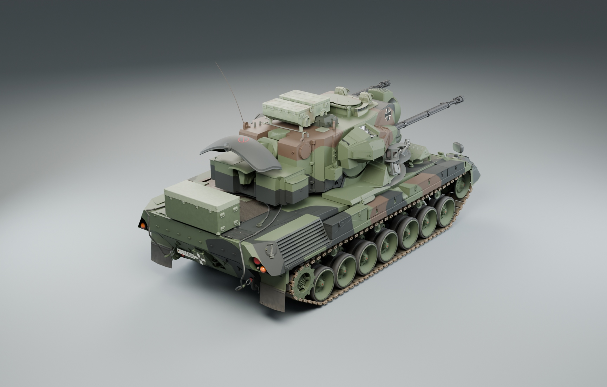

# Gepard 1A2 · R62

A Blender exterior study in three-color camouflage. **Base** has a clear rear deck. **Equipped** carries two roof cases, a rear stowage chest and an amber beacon.

**[View the R62 gallery and turntable](galleries/R62.md)**

| Base · rear quarter | Equipped · rear quarter |
| --- | --- |
|  |  |

In the close-ups, light catches the fluted road-lamp glass, the rolled edge of the front mudguard and the shallow fold across the rear splash panel. [See the exterior details](galleries/R62.md#exterior-details).

[R57 gallery](galleries/R57.md) · [Archived R57 overview](https://github.com/mortal414/gepard-blender-showcase/blob/6ca17421293470e3a1d5e5ab45517115e4410af0/README.md) · [Showcase history](HISTORY.md) · [Rights and attribution](RIGHTS.md)
