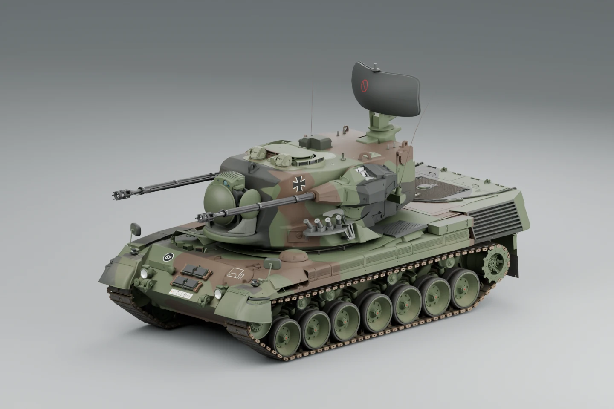
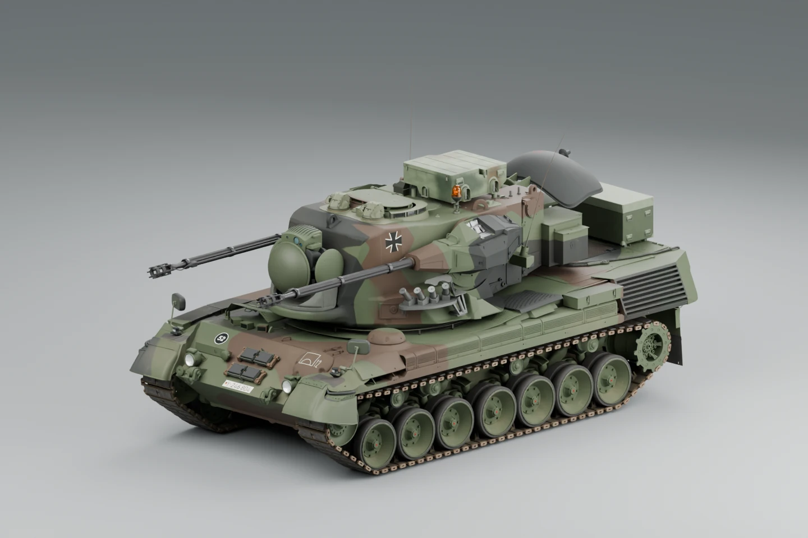
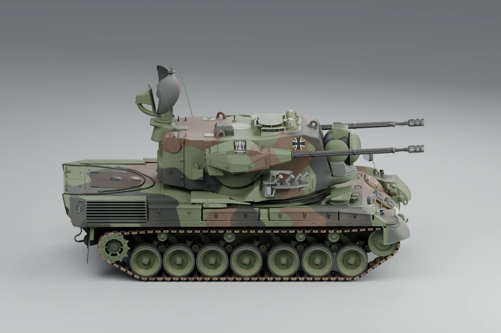
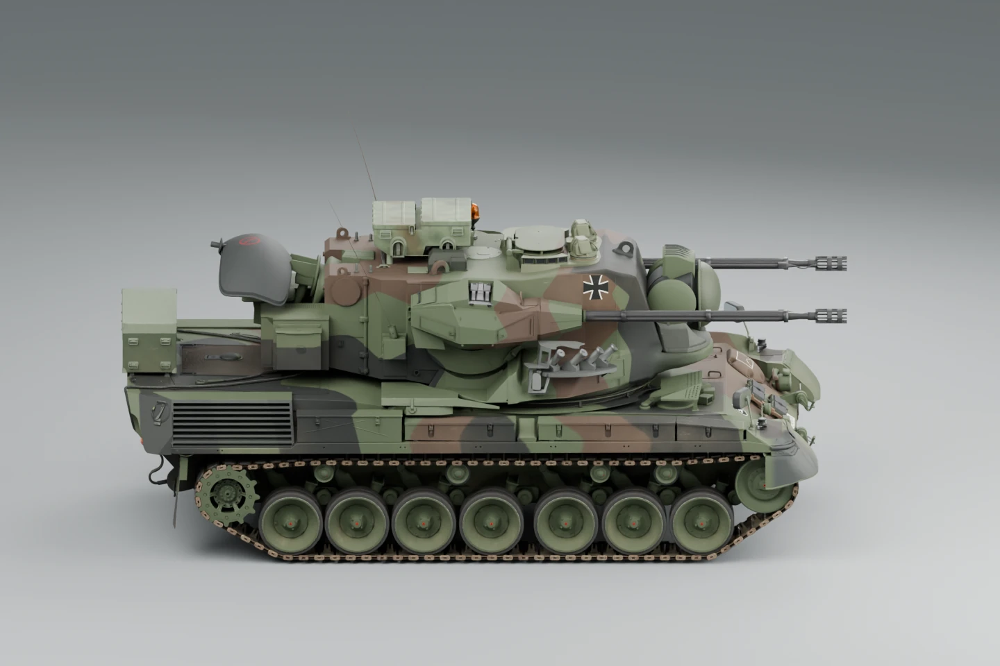
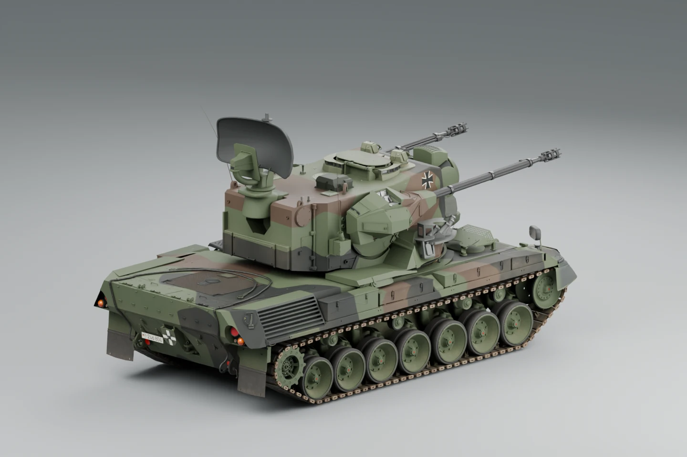
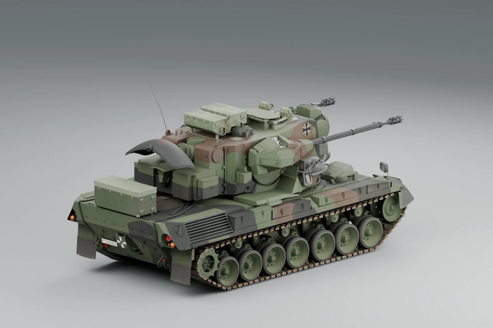
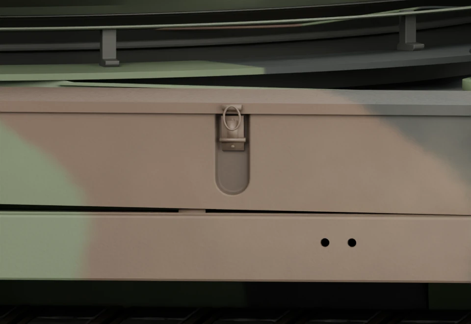
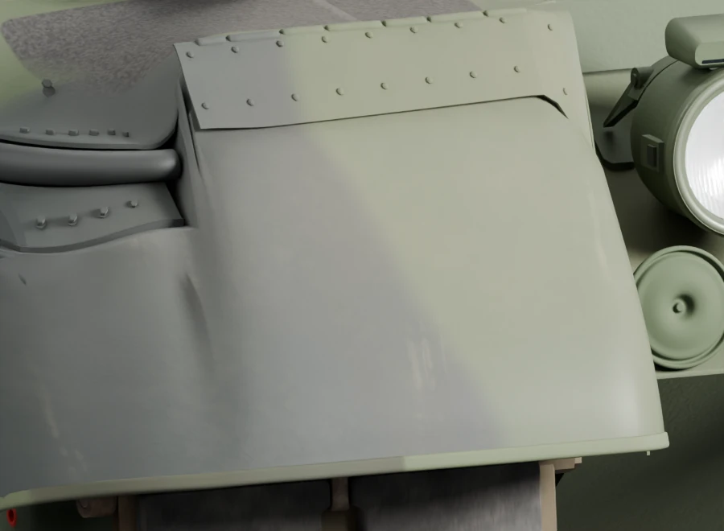
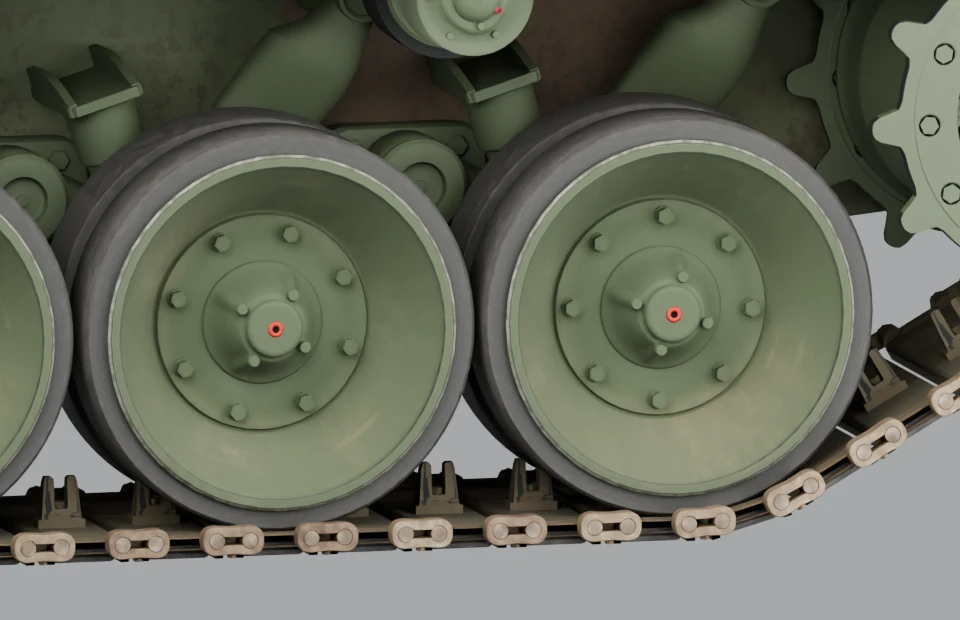
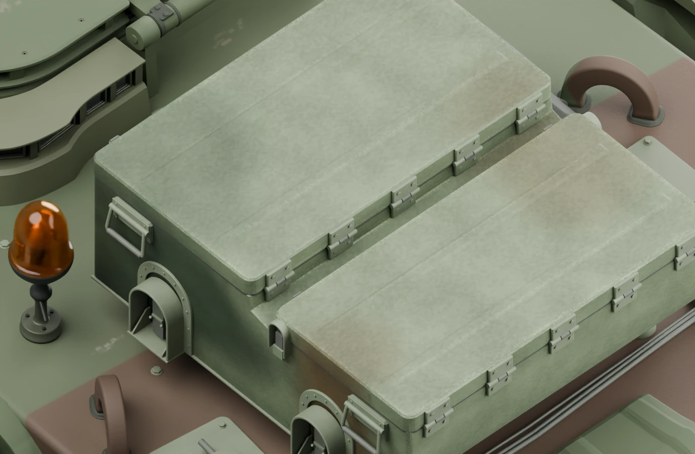

# Material02 · Exterior gallery

The Base and Equipped Blender game-art variants share three-color camouflage. In this finish pass, paint carries into the starboard locker recesses, the wheel dishes vary subtly in finish, and fine scuffs catch the light on the front fenders.

[Overview](../README.md) · [Interactive gallery](https://mortal414.github.io/gepard-blender-showcase/) · [Surface details](#surface-details) · [Turntables](#turntables)

## Matched wide views

| View | Base | Equipped |
| --- | --- | --- |
| Port front quarter |  |  |
| Starboard profile |  |  |
| Starboard rear quarter |  |  |

## Surface details

| Paint and finish | Fenders and stowage |
| --- | --- |
|  **Locker recess.** The color continues inside the latch pocket. |  **Front fender.** Fine scuffs catch the light in the satin finish. |
|  **Wheel dish.** The sheen varies gently across the lower bowl. |  **Roof case.** The hinge follows the edge of the fitted lid. |

## Turntables

Each six-second clip makes one revolution around the stationary artwork.

- [Base turntable](../docs/media/base-turntable.mp4)
- [Equipped turntable](../docs/media/equipped-turntable.mp4)

[R62 gallery](R62.md) · [R57 gallery](R57.md) · [Showcase history](../HISTORY.md) · [Rights and attribution](../RIGHTS.md)
