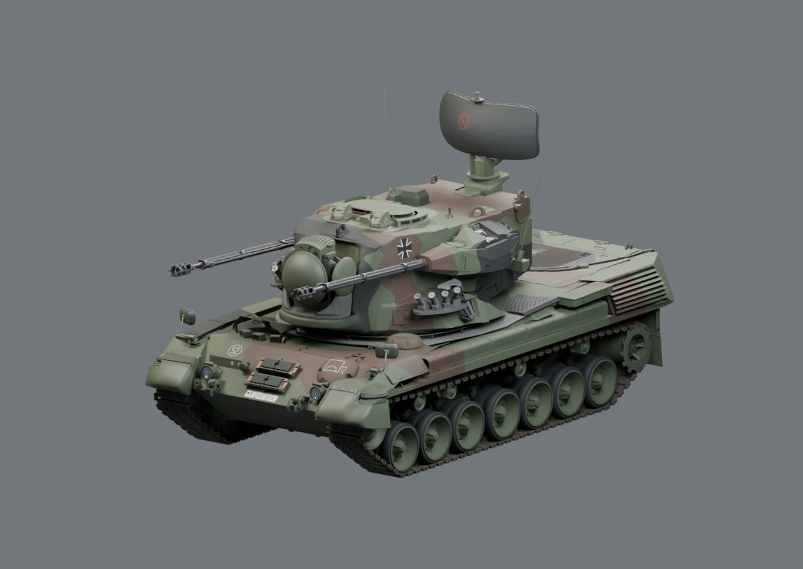
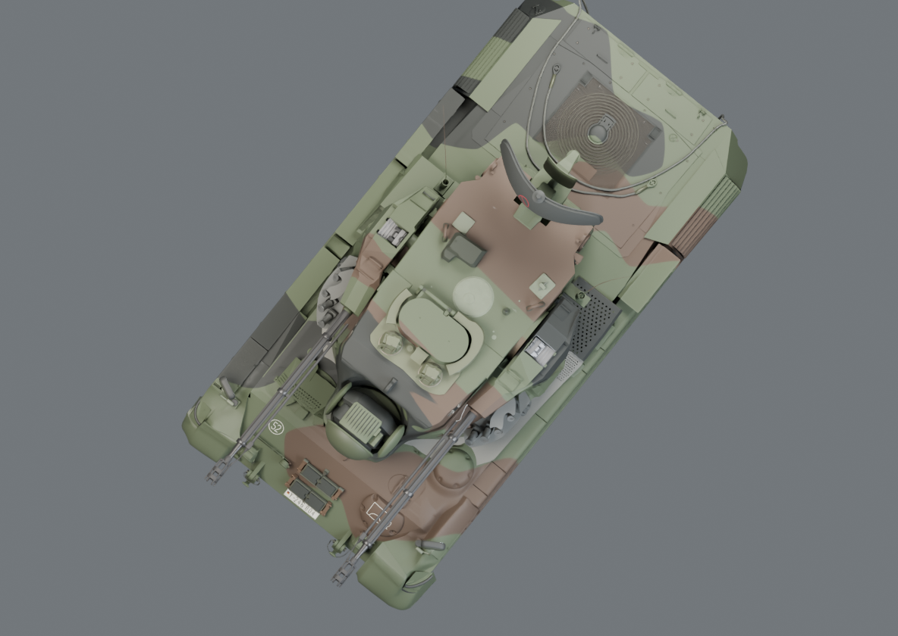
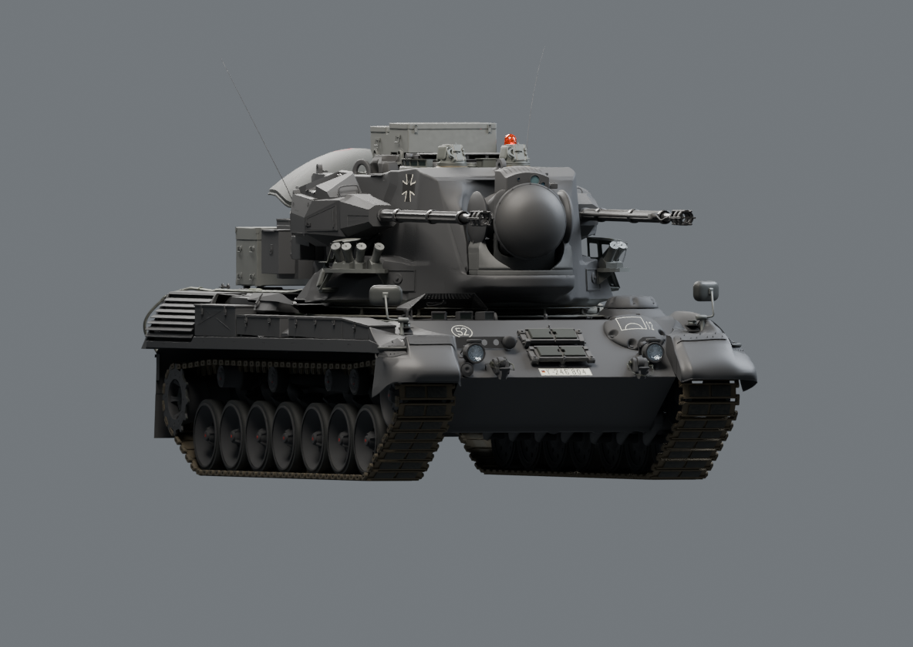
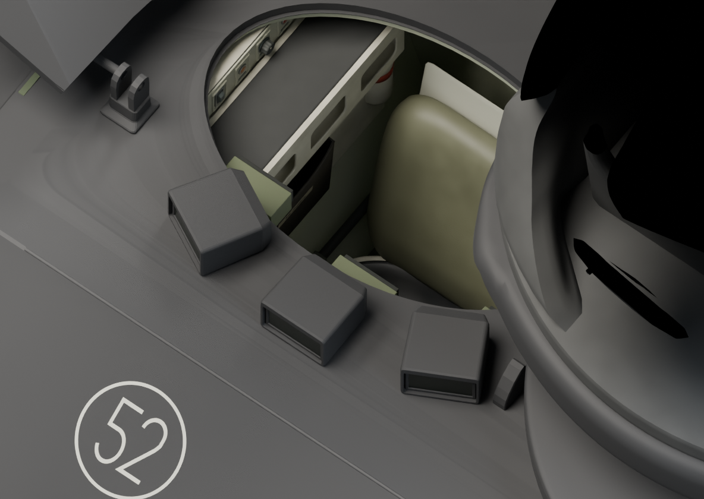

# R47 model gallery

Exterior and interior views of the current reviewed model, with Base as the default and Equipped showing the optional stowage and beacon. Paint and skins are provisional.

[Model overview](../README.md) · [Base](#base) · [Equipped](#equipped) · [Revision history](../HISTORY.md) · [Rights and attribution](../RIGHTS.md)

## Base

Removable stowage boxes and roof beacon off.

[Model details and private Blender download](../models/R47-Base.md)

### Base exterior

| View | View |
| --- | --- |
|  |  |
|  |  |

### Base interior

| Driver’s cabin | Crew compartment |
| --- | --- |
|  |  |

## Equipped

Optional roof boxes, rear stowage and amber roof beacon fitted.

[Model details and private Blender download](../models/R47-Equipped.md)

### Equipped exterior

| View | View |
| --- | --- |
|  |  |
|  |  |

### Equipped interior

| Driver’s cabin | Crew compartment |
| --- | --- |
|  |  |

[Rendering provenance](../images/r47/RENDERING.md) · [Image checksums](../images/r47/manifest.json) · [Model download verification](../images/r47/DOWNLOAD-VERIFICATION.json)
