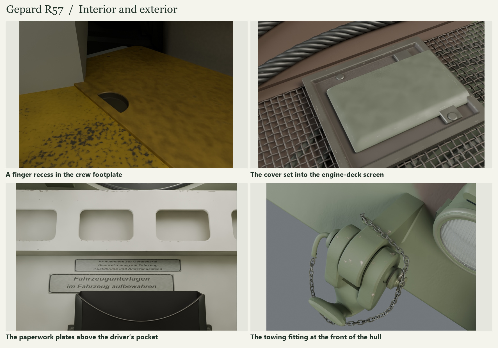
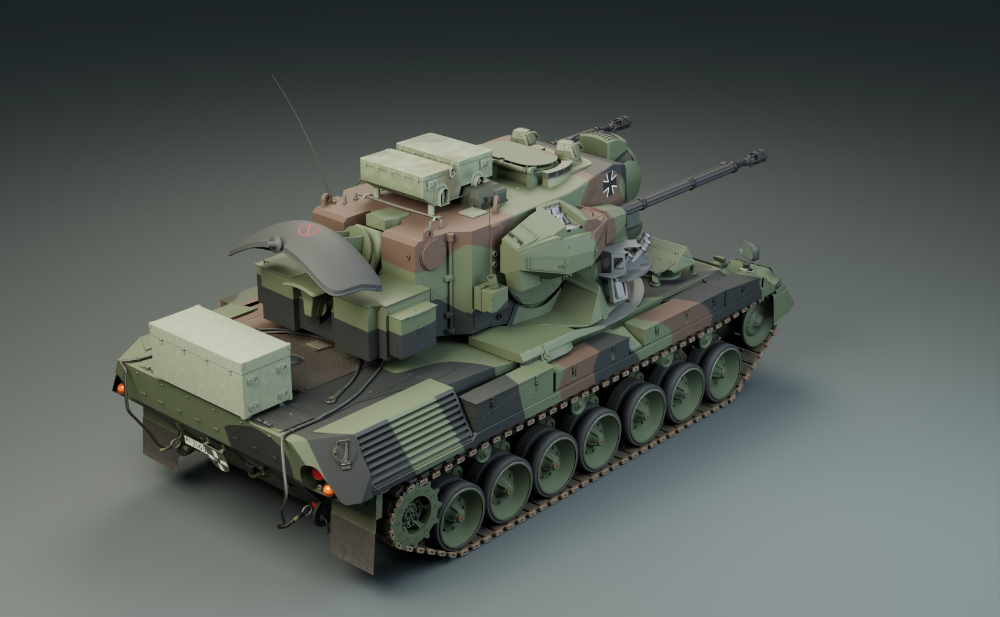

# R57 revision details and supplied renders

[Whole-model overview](../README.md) · [Fresh studio gallery](R57.md) · [Revision history](../HISTORY.md)

This secondary record shows the local refinements from R56: recessed finger pulls and a closed seam on the crew footplates; a folded enamel edge and paperwork on the driver’s shelf; a rebuilt rear-deck screen cover; and pin retainers, tethers and localized paint wear on the front towing fittings.

## Supplied model-only portraits

These two supplied Camo views are retained alongside the fresh studio set.

[Rights and attribution](../RIGHTS.md)
