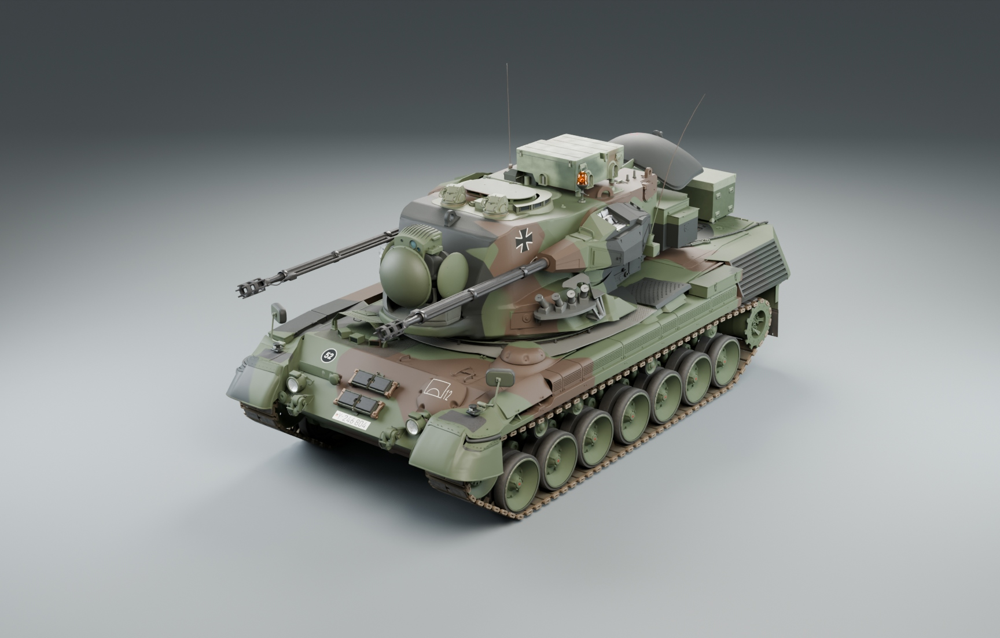
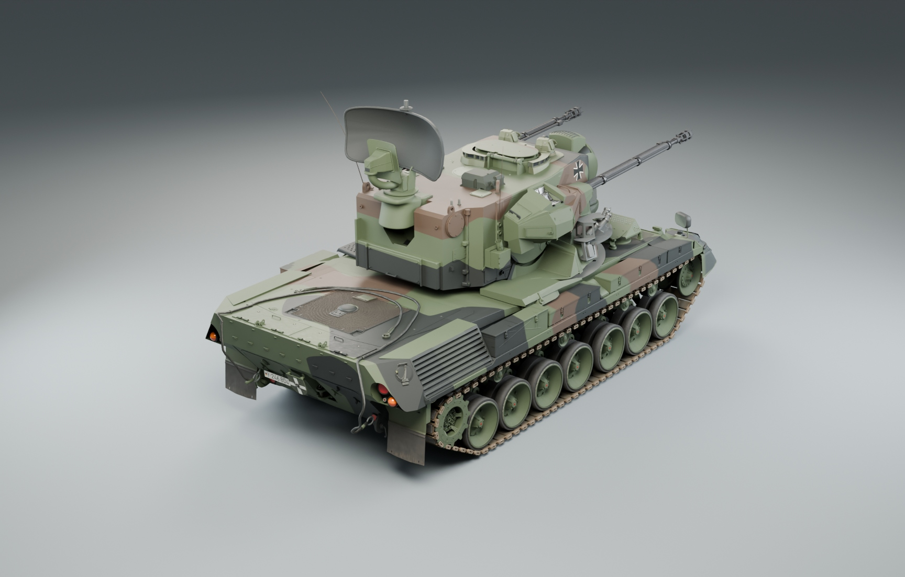
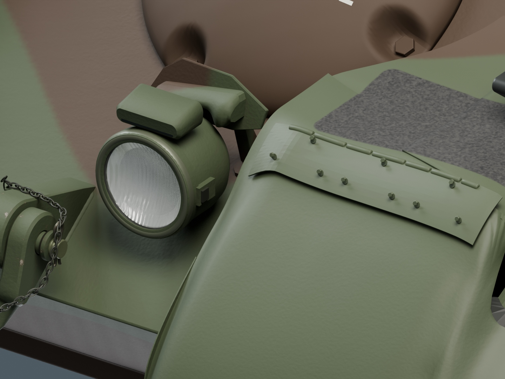
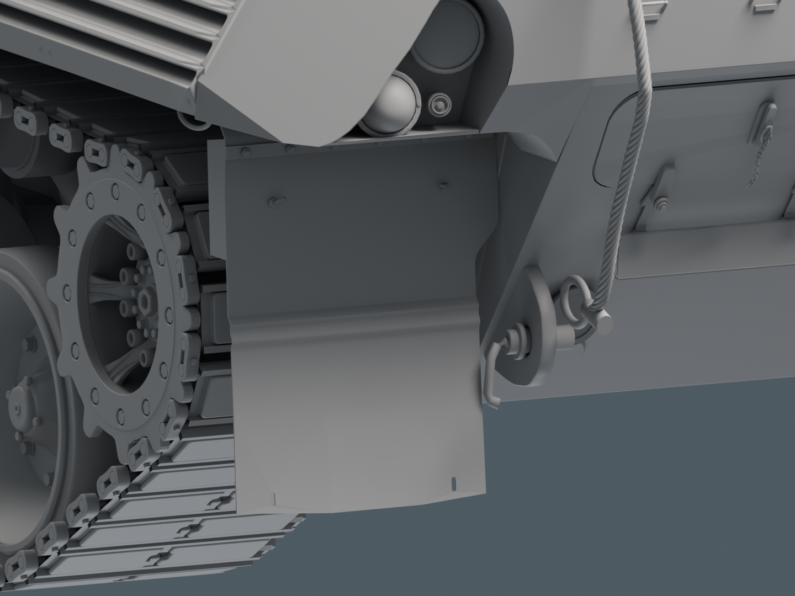

# R62 · Exterior gallery

Base and Equipped share the same camouflage. The paired views use the same camera and lighting. Select an image for the full-size render.

[Overview](../README.md) · [Exterior details](#exterior-details) · [Equipped turntable](#equipped-turntable)

## Front quarter

| Base | Equipped |
| --- | --- |
|  |  |

## Rear quarter

| Base | Equipped |
| --- | --- |
|  |  |

## Side view

| Base | Equipped |
| --- | --- |
|  |  |

## Exterior details

**Base · Front mudguard and road lamp.** The rolled edge picks up a narrow highlight beside the fluted glass.

**Equipped · Roof stowage.** The hinges follow the edges of the pale green case lids. The amber beacon sits alongside.

**Base · Rear splash panel.** Neutral clay shows the shallow horizontal fold and the shape of the lower edge.

## Equipped turntable

A six-second camera orbit around the stationary Equipped model.

[R57 gallery](R57.md) · [Showcase history](../HISTORY.md) · [Rights and attribution](../RIGHTS.md)
